<div align="center">
  
  <h1>ZeroBit Player</h1>
  <p><b>基于 Flutter + Rust 的 Material 3 风格的多功能本地音乐播放器</b></p>

  <div>
    <a href="https://deepwiki.com/Empty-57/ZeroBit-Player"></a>
    
    
    
    
    
    
    <a href="https://wakatime.com/badge/user/7dfa2142-9f15-461d-ba44-2a9e14966a3b/project/e540bf5c-e190-4823-b0bd-02e367cbfa2b"></a>
    <a href="https://linux.do"></a>
  </div>

  <br>

  <p>
    <a href="https://github.com/Empty-57/ZeroBit-Player/releases/latest"><b>[ 立即下载最新版 ]</b></a> •
    <a href="https://empty-57.github.io/ZeroBit-Player/"><b>[ 官方文档 ]</b></a> •
    <a href="https://qm.qq.com/q/vfKdauUU12"><b>[ QQ 交流群 ]</b></a>
  </p>

  <sub>Logo 来源：阿里巴巴矢量图标库</sub>
</div>

---

<div align="center">
  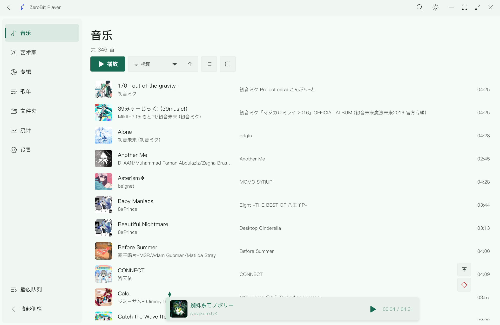
</div>

## 核心特性

### 音频内核与硬件级播放
- **专业级音频引擎**：基于 `BASS` 强大音频内核，低延迟、高保真。
- **WASAPI 独占输出**：支持硬件独占通道输出，跳过系统混音，还原纯净音质。
- **高级音频控制**：内置多段均衡器调节、ReplayGain 音量平衡、实时跳动音频频谱可视化。
- **系统集成**：完整支持 Windows 系统级媒体传输控件 (SMTC)、taskToolBar(系统任务栏缩略图工具栏)播放控制、全局系统媒体快捷键与后台播放。

### 完善的歌词系统
- **多格式解析支持**：原生支持 `QRC`、`KRC`、`YRC` 加密格式，以及标准逐行、逐字与增强型 `LRC`。
- **假名分析与注音支持**：支持日语分词注音、罗马音、原文与翻译同屏平滑滚动。
- **独立悬浮桌面歌词**：基于独立进程实现的透明轻量级悬浮桌面歌词，横竖排双向随心切换。
- **在线歌词与内嵌读写**：支持网络在线精确检索歌词，并可直接写回音频文件内嵌标签。

### 现代 Material 3 美学
- **动态色彩（Material You）**：智能提取当前播放曲目专辑封面主色，实时动态变换全局主题。
- **极佳的视觉动效**：流体 Mesh 渐变背景、3D 卡片倾斜动效与高帧率过渡动画。
- **自由定制**：全面支持深色/浅色模式、自定义字体、主题强调色调节。

### 本地曲库与数据处理
- **多格式支持**：涵盖主流无损与高解析度音频格式（FLAC、DSD、APE、WavPack、Opus 等）。
- **元数据读写**：基于 Rust `Lofty` 库无阻塞解析与修改 ID3v1/ID3v2、Vorbis、APE 等标签。
- **听歌数据统计**：内置本地听歌热力图、播放时段习惯分析、单曲与歌手排行榜。

---

## 支持的格式

### 1. 支持的音频格式
> `aac`、`ape`、`aiff`、`aif`、`flac`、`mp3`、`mp4` (`m4a`, `m4b`, `m4p`, `m4v`)、`mpc`、`opus`、`ogg`、`oga`、`spx`、`wav`、`wv`、`dff`、`dsf`

### 2. 支持的歌词格式
> `qrc`、`krc`、`yrc`、标准逐行 `lrc`、逐字 `lrc`、增强型 `lrc`

### 3. 音频元数据 (Metadata) 读写支持
| 音频格式               | 元数据标签标准              |
|:-----------------------|:----------------------------|
| **AAC (ADTS)**         | `ID3v2`, `ID3v1`            |
| **APE**                | `APE`, `ID3v2`*, `ID3v1`    |
| **AIFF**               | `ID3v2`, `Text Chunks`      |
| **FLAC**               | `Vorbis Comments`, `ID3v2`* |
| **MP3**                | `ID3v2`, `ID3v1`, `APE`     |
| **MP4 / M4A**          | `iTunes-style ilst`         |
| **MPC**                | `APE`, `ID3v2`*, `ID3v1`*   |
| **Opus / Ogg / Speex** | `Vorbis Comments`           |
| **WAV**                | `ID3v2`, `RIFF INFO`        |
| **WavPack**            | `APE`, `ID3v1`              |

> \* 由于缺乏官方支持，该标签只能被**读取**，无法被修改。

---

## 进阶歌词与封面指南

### 歌词检索与优先级机制
1. **查找本地外部歌词**：优先匹配歌曲同目录下的同名文件。
   * 格式优先级：`同名逐字文件 (.qrc / .krc / .yrc)` ➔ 同名 `.lrc` 作为翻译数据。
2. **读取文件内嵌歌词**：若同目录下无独立歌词文件，则自动解析音频内嵌标签。
3. **网络精准检索**：若均未命中，可在播放界面通过歌曲/歌手信息在线搜索，并支持“一键写入内嵌”或“下载到本地目录”。

### 复杂 LRC 多行注音解析规则
若使用的 `.lrc` 包含罗马音/注音与翻译，播放器将按照以下规则渲染：
- **三行同时间戳**：第一行为注音，第二行为原文，第三行为翻译：
  ```lrc
  [00:24.212]qi yo to ma ga sa xi ta n da    -> 自动作为注音
  [00:24.212]ちょっと魔がさしたんだ          -> 自动作为原文
  [00:24.212]我是有点鬼迷心窍了              -> 自动作为翻译
  ```
- **单行复合歌词**：自动通过 ` / ` 进行切分拆解：
  ```lrc
  [00:24.21]ちょっと魔がさしたんだ / 我是有点鬼迷心窍了  -> 前半为原文，后半为译文
  ```
> **搭配 LDDC 工具建议**：若使用 [LDDC](https://github.com/chenmozhijin/LDDC) 匹配歌词，建议在 LDDC 设置的歌词顺序中勾选 `罗马音 -> 原文 -> 译文`，以获得最佳渲染兼容性。

---

## 开发与构建指南

### 环境要求
- **操作系统**：Windows 10 / 11 (x64)
- **Flutter SDK**：3.44+
- **Rust Toolchain**：1.92+

### 1. 克隆与依赖安装
```bash
# 获取源码
git clone https://github.com/Empty-57/ZeroBit-Player.git
cd ZeroBit-Player

# 安装 Flutter 依赖
flutter pub get
```

### 2. 生成 FRB 跨语言绑定
```bash
# 监听并自动生成 Flutter Rust Bridge 胶水代码
flutter_rust_bridge_codegen generate --watch
```

### 3. 配置原生依赖库（重要）

> [!IMPORTANT]
> 运行或打包前，必须确保以下原生文件放置到位：
> 1. 将 **BASS 64 位动态链接库** 复制至软件根目录的 `BASSDLL/` 文件夹下：
>    * `bass.dll`、`bass_fx.dll`、`basswasapi.dll`、`bassflac.dll`、`bassalac.dll`、`bassape.dll`、`bassdsd.dll`、`bassmidi.dll`、`bassopus.dll`、`basswebm.dll`、`basswv.dll`
> 2. 将编译好的 [Zerobit Player Desktop Lyrics](https://github.com/Empty-57/zerobit_player_desktop_lyrics) 产物复制到软件根目录的 `desktop_lyrics/` 文件夹下以启用悬浮桌面歌词。

### 4. 运行与编译
```bash
# 启动开发调试
flutter run

# 构建 Release 正式版本
flutter build windows --release
```

---

## 常见问题排查

> [!WARNING]
> **软件发生严重异常或配置损坏时如何重置？**
> * 软件配置文件存储在：`C:\Users\<你的用户名>\Documents\zerobit_config`
> * 如果遇到启动闪退或严重配置异常，只需彻底退出软件，进入该目录**删除所有 `.hive` 与 `.lock` 后缀文件**，再次启动即可恢复初始默认设置。
> * 日志存放路径位于：`C:\Users\<你的用户名>\Documents\zerobit_logs`。

---

## 软件界面一览

### 播放页面与桌面歌词
<div align="center">
  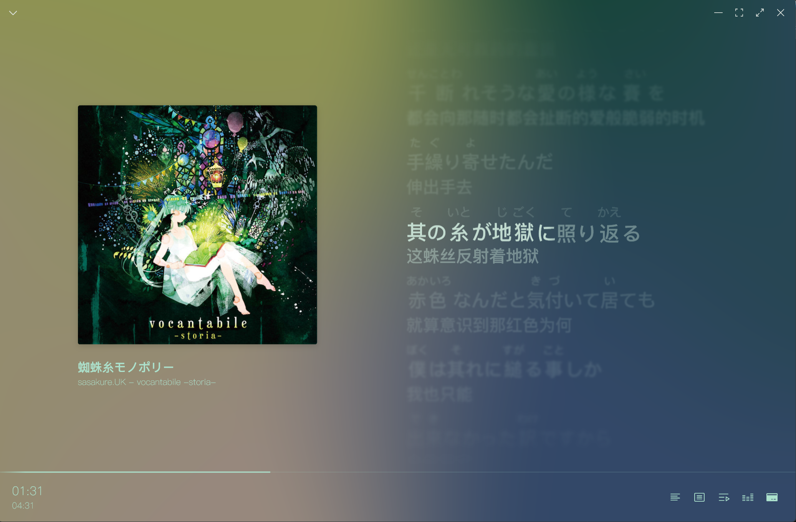
  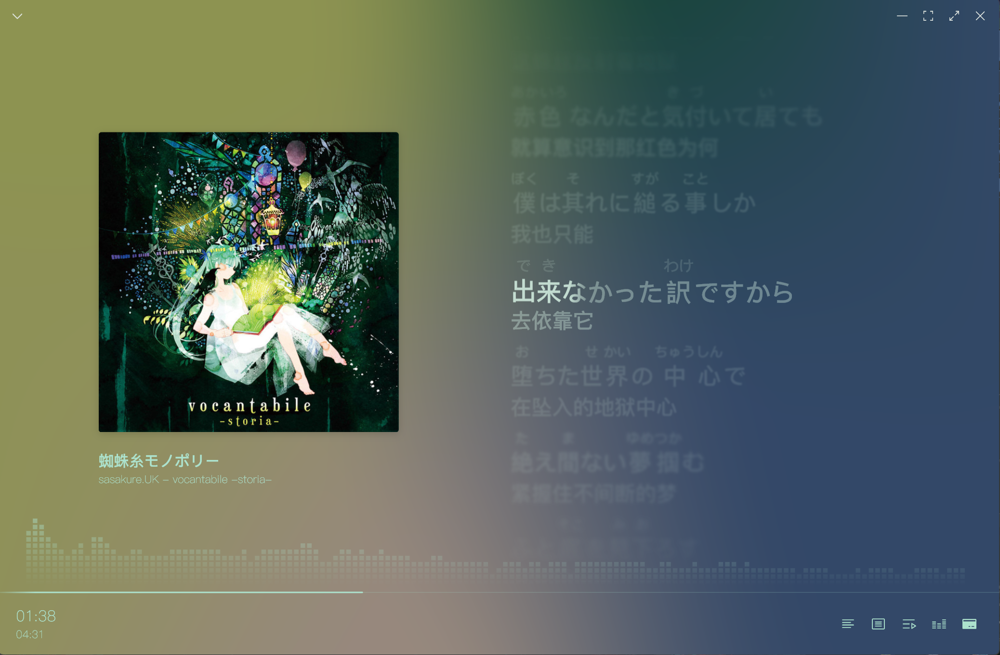
</div>

<div align="center">
  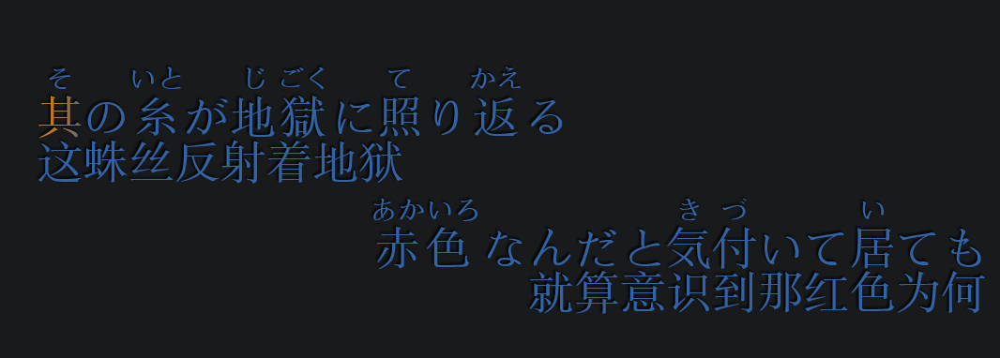
  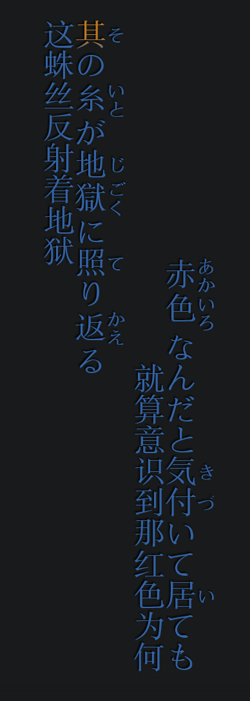
  <p><sub>桌面歌词（横排 / 竖排）</sub></p>
</div>

<details>
<summary><b>点击展开：浅色模式预览</b></summary>
<br>

<div align="center">
  
  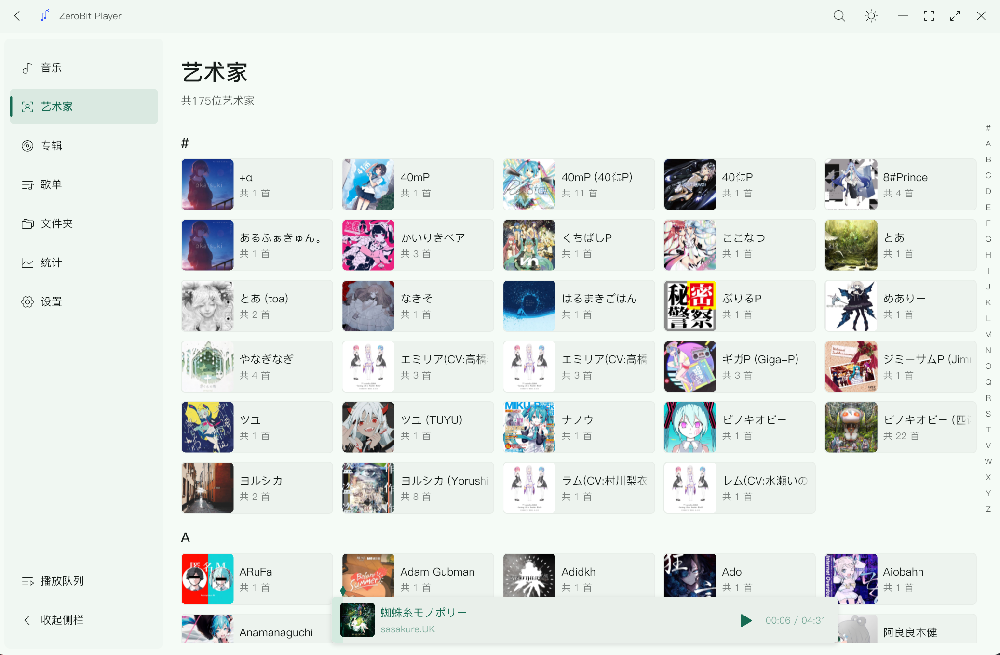
  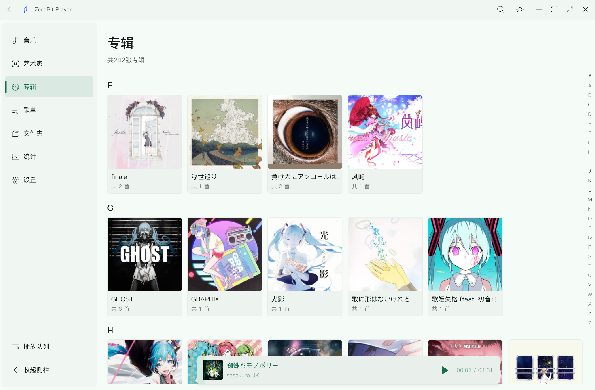
  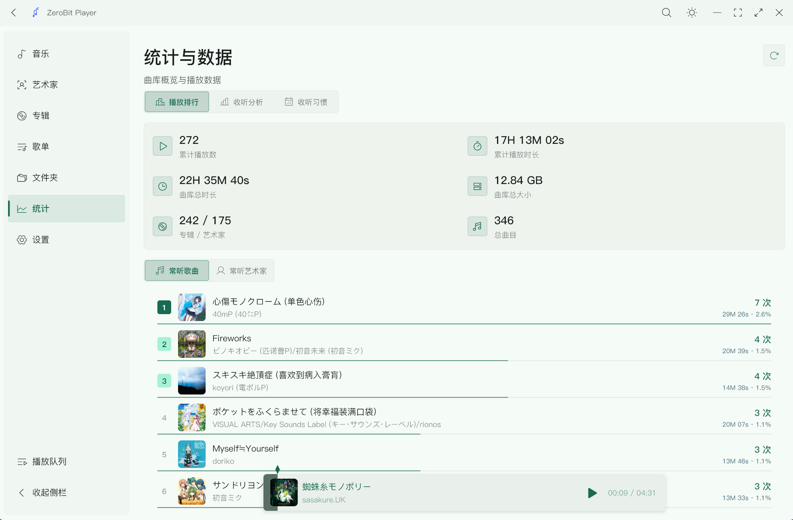
  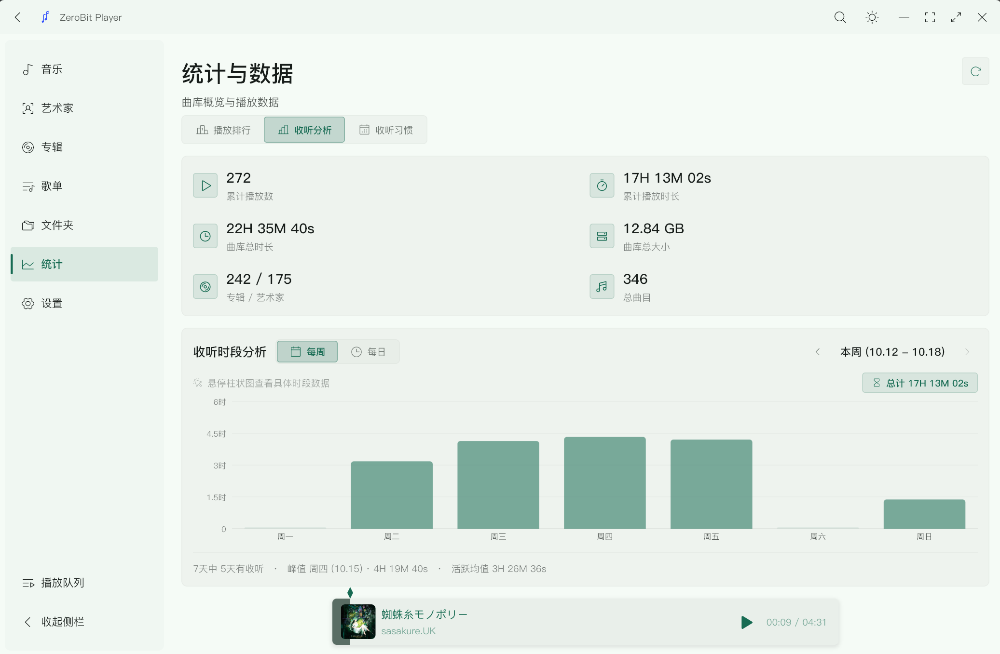
  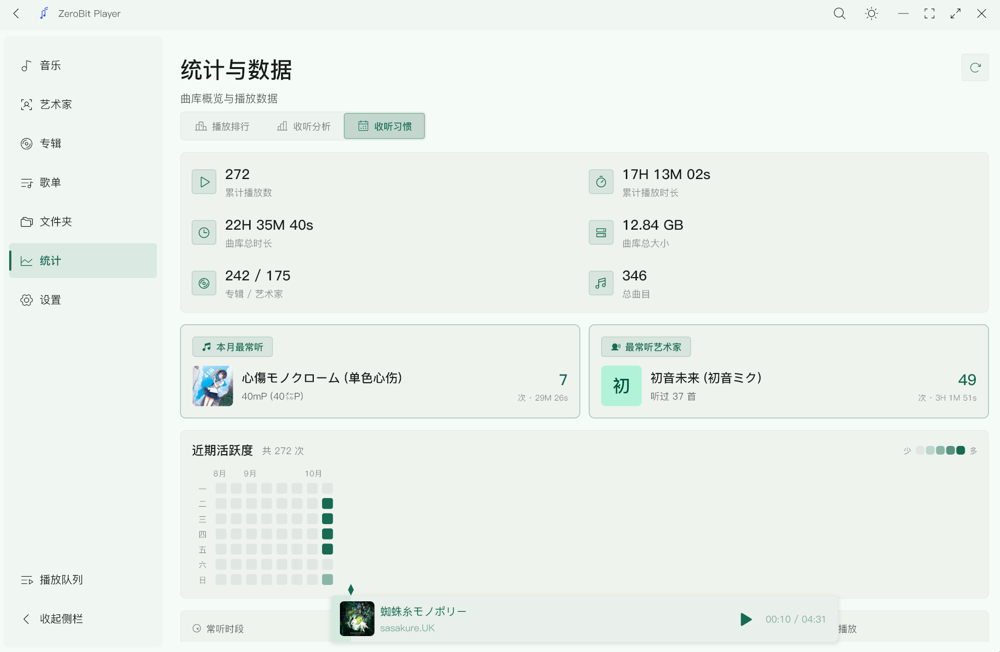
</div>
</details>

<details>
<summary><b>点击展开：深色模式预览</b></summary>
<br>

<div align="center">
  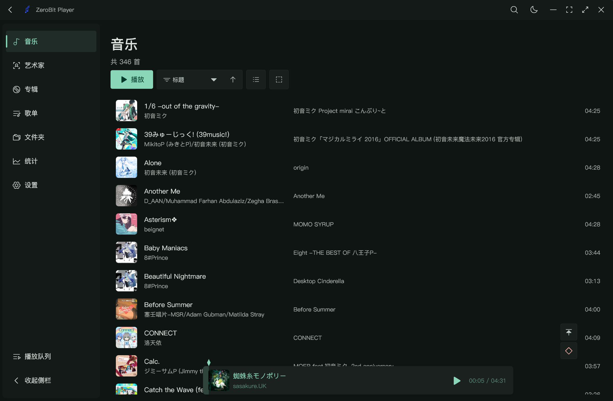
  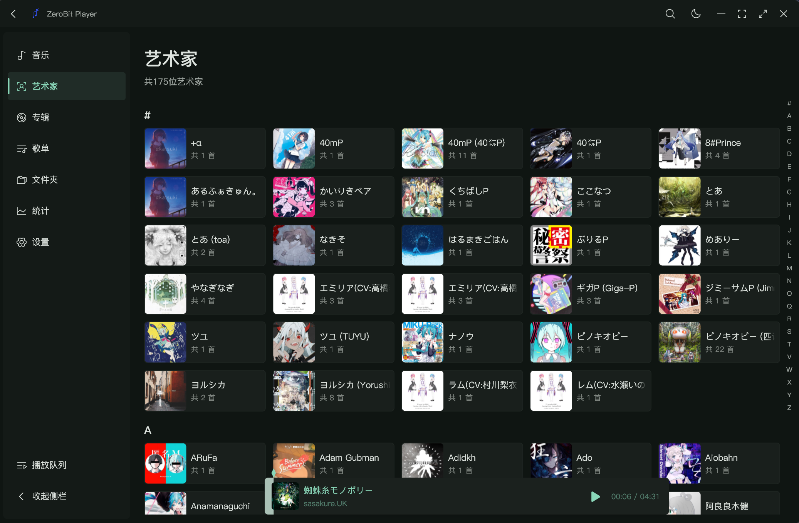
  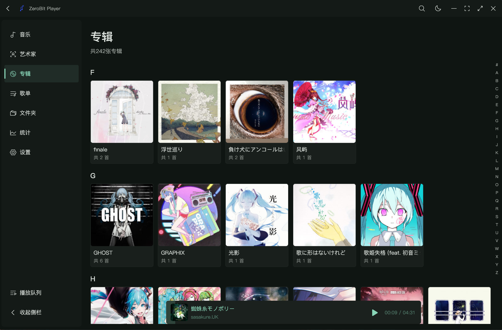
  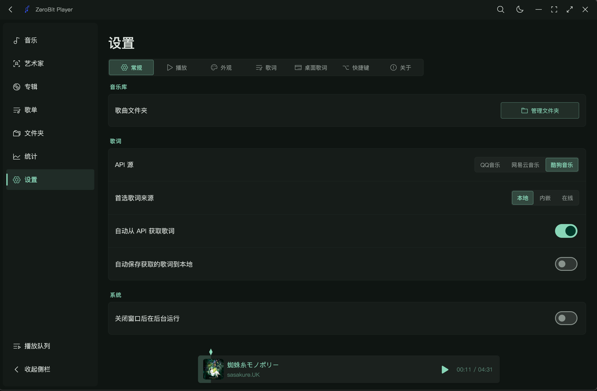
</div>
</details>

---

## 鸣谢与致敬

项目在开发过程中深受以下优秀开源项目的启发与支持：
- [coriander_player](https://github.com/Ferry-200/coriander_player) & [Pure-music](https://github.com/qingyueyin/Pure-music) — UI 界面设计参考
- [BASS](https://www.un4seen.com/) — 强大的底层音频内核
- [Lofty](https://crates.io/crates/lofty) — 极速且健壮的 Rust 音频标签库

---

## 贡献与赞助

欢迎提交 [Issue](https://github.com/Empty-57/ZeroBit-Player/issues) 反馈 Bug，或直接发起 [Pull Request](https://github.com/Empty-57/ZeroBit-Player/pulls) 参与贡献！

提交前请阅读 [贡献指南](.github/CONTRIBUTING.md)，了解 [Issue 提交规范](.github/CONTRIBUTING.md#issue-提交规范) 和 [PR 提交规范](.github/CONTRIBUTING.md#pr-提交规范)。

如果你认可这个项目并希望它变得更好，欢迎请作者喝杯咖啡：

<div align="center">
  <a href="https://ifdian.net/a/emp57"><b>[ 前往爱发电赞助 ]</b></a>
  <br><br>
  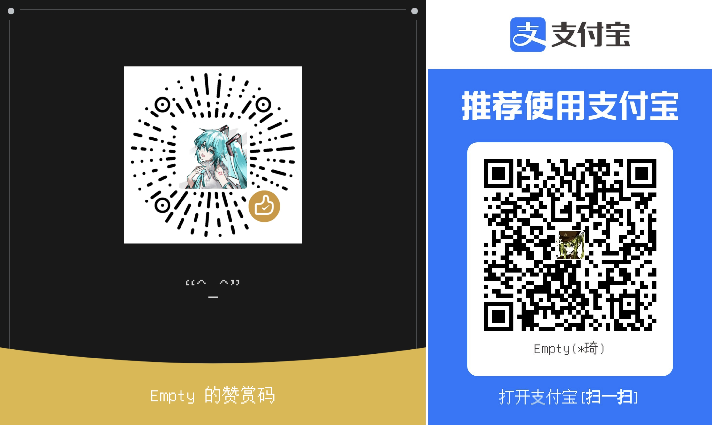
</div>
